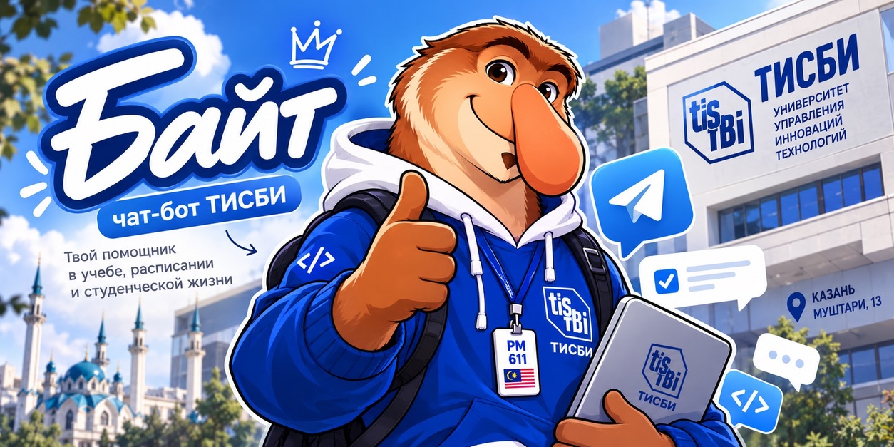
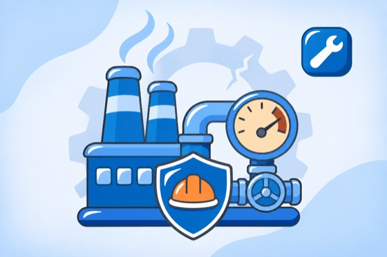
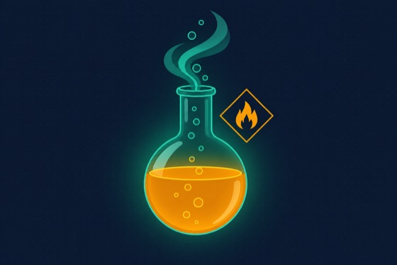
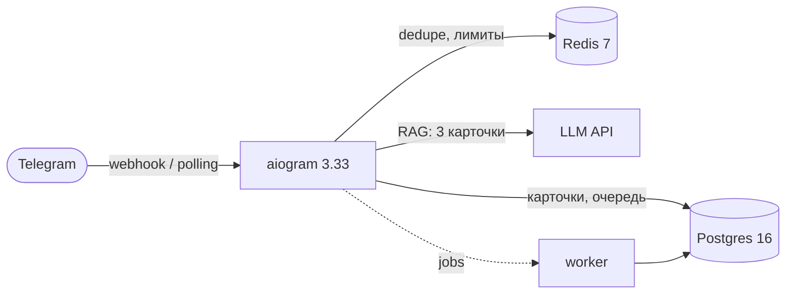

<p align="center">
  
</p>

<p align="center"><b>Байт — свой в ТИСБИ</b><br>59 карточек «что делать» при ЧС, 177 вопросов для самопроверки и ИИ-помощник, который отвечает только по этим карточкам.</p>

<p align="center">
  <a href="https://t.me/ByteTisbi_bot"></a>
  
  
  
  
  
  
  <a href="https://github.com/lukavtz/byte-guardian/actions/workflows/ci.yml"></a>
  <a href="https://github.com/lukavtz/byte-guardian/actions/workflows/deploy.yml"></a>
  <a href="https://github.com/lukavtz/byte-guardian/pkgs/container/byte-guardian"></a>
</p>

<p align="center">Живой бот — <a href="https://t.me/ByteTisbi_bot">@ByteTisbi_bot</a>. Прод — Altare, Ubuntu 24.04, polling.</p>

<p align="center"><sub>CI: lint, types, tests, content sources, image build; CD: auto-deploy on main.</sub></p>

<p align="center"><b>Фирменный стиль ТИСБИ.</b> Официальный синий <code>#0477D2</code>, акцент <code>#FD8749</code>, чернила <code>#444B54</code> и льдистый фон <code>#F4F8FF</code>; маскот — Байт в худи ТИСБИ. Система целиком — <a href="docs/BRAND.md">docs/BRAND.md</a>.</p>

## Что умеет

- **8 разделов, 59 карточек.** Признаки, шаги до / во время / после, запреты и телефоны.
- **Тест после карточки.** 177 вопросов по 3 на карточку: разбор ответа и счёт.
- **Поиск везде.** Меню и inline-режим: `@ByteTisbi_bot утечка хлора`.
- **Байт в группах.** Отвечает по упоминанию или реплаю, опираясь на три релевантные карточки.
- **4 языка.** ru / en / zh / tt; если перевода нет — карточка на ru с бейджем `RU`.
- **Rich Messages.** Заголовки, `details`, blockquote, футер и сгруппированные кнопки.

## Разделы

<table align="center">
  <tr>
    <td align="center" width="25%"><br><b>Пожар</b><br><sub>7 карточек</sub></td>
    <td align="center" width="25%"><br><b>Терроризм и захват</b><br><sub>7 карточек</sub></td>
    <td align="center" width="25%"><br><b>Техногенные аварии</b><br><sub>8 карточек</sub></td>
    <td align="center" width="25%"><br><b>Природные ЧС</b><br><sub>8 карточек</sub></td>
  </tr>
  <tr>
    <td align="center" width="25%"><br><b>Химическая опасность</b><br><sub>7 карточек</sub></td>
    <td align="center" width="25%"><br><b>Первая помощь</b><br><sub>8 карточек</sub></td>
    <td align="center" width="25%"><br><b>Радиация</b><br><sub>7 карточек</sub></td>
    <td align="center" width="25%"><br><b>Кибербезопасность</b><br><sub>7 карточек</sub></td>
  </tr>
</table>

## Экраны

| Экран | Что на нём |
|---|---|
| Меню | 8 разделов, поиск, язык, настройки и переключатель рассылок. |
| Карточка | Признаки, действия до / во время / после, запреты, контакты. |
| Тест | 3 вопроса с разбором и итоговым счётом. |

## Быстрый старт

Публичный инстанс — [@ByteTisbi_bot](https://t.me/ByteTisbi_bot). Локально нужен только Podman; прод — нативно на Altare, [docs/RUN.md](docs/RUN.md#8-прод-altare-ubuntu-2404).

```bash
cp .env.example .env     # BOT_TOKEN, WEBHOOK_SECRET, POSTGRES_PASSWORD, REDIS_PASSWORD, LLM_API_KEY

# Готовый образ (теги — v* и latest):
docker pull ghcr.io/lukavtz/byte-guardian:latest

podman machine init      # macOS, один раз
podman machine start

podman compose up -d --build
curl -fsS localhost:8080/healthz   # {"ok": true}
```

`BOT_MODE=polling` по умолчанию: TLS и домен не нужны, так работает прод. Webhook — опция: `podman compose --profile webhook up -d --build` с `BOT_MODE=webhook` и `WEBHOOK_URL=https://<домен>`; Caddy (`deploy/Caddyfile`) терминирует TLS. Диагностика — [docs/RUN.md](docs/RUN.md).

## Настройка

Секреты живут только в `.env` (он в `.gitignore`). Файлы `*_FILE` имеют приоритет над переменными.

| Переменная | Зачем |
|---|---|
| `BOT_TOKEN` | Токен бота от @BotFather. |
| `BOT_MODE` | `polling` для разработки, `webhook` для прода. |
| `WEBHOOK_URL`, `WEBHOOK_SECRET` | Только для webhook; секрет проверяется в заголовке. |
| `ADMIN_IDS` | Telegram ID админов через запятую. |
| `POSTGRES_PASSWORD`, `REDIS_PASSWORD` | Пароли хранилищ; compose собирает DSN сам. |
| `LLM_BASE_URL`, `LLM_MODEL`, `LLM_API_KEY` | Любой OpenAI-совместимый провайдер. |
| `DATABASE_URL`, `REDIS_URL` | Нужны только вне compose. |

## Архитектура



`bot` принимает апдейты и редактирует экраны на месте; `worker` разбирает очередь (рассылки и LLM-запросы); `migrate` накатывает Alembic. Redis хранит dedupe `update_id` на 24 часа и лимиты, Postgres — источник правды. `caddy` включается только профилем `webhook`.

## Команды

| Команда | Кто | Что делает |
|---|---|---|
| `/start` | все | Меню разделов. |
| `/help` | все | Справка и ссылки. |
| `/settings` | все | Язык и рассылки. |
| `/ask <вопрос>` | все | Ответ Байта по карточкам. |
| `/admin` | `ADMIN_IDS` | Статистика и тумблеры разделов. |
| `/broadcast <html>` | `ADMIN_IDS` | Черновик рассылки с подтверждением. |

## Контент и источники

- Карточки — JSON в `content/`, сидятся в Postgres; Postgres остаётся источником правды.
- Байт не ищет в интернете: на вопрос выбираются 3 карточки, ответ — до 700 знаков со ссылкой на раздел.
- Если факта в карточках нет, Байт говорит об этом, а не додумывает.
- При угрозе жизни первая строка — «Звоните 112». Диагнозы и дозировки исключены; материал не заменяет МЧС и врача.

## Разработка

```bash
uv sync && uv run pytest -q              # 478 passed
uv run ruff check . && uv run mypy app
```

CI гоняет те же проверки на Python 3.14. Решения по навигации, RAG и рендеру — [docs/DESIGN.md](docs/DESIGN.md).

## Лицензия

GPL-3.0-only. Название и знаки TISBI, а также artwork исключены из лицензии и остаются собственностью владельцев. Подробности — [LICENSE](LICENSE).
